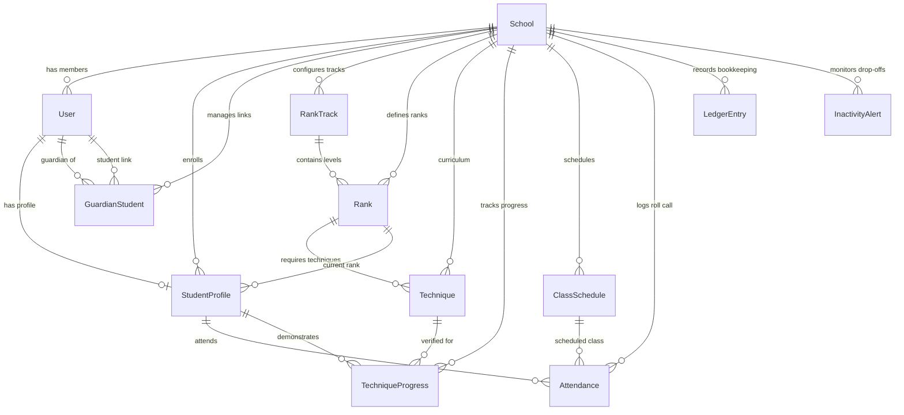

# BeltTrack Database Architecture & Schema Specification

This document provides a comprehensive architectural analysis of all 12 tables defined in [`prisma/schema.prisma`](prisma/schema.prisma) for the BeltTrack platform.

---

## Architectural Principles

1. **Strict Multi-Tenant Isolation**: Every private record binds to `school_id` (`schoolId`) as a foreign key with cascade deletion. Cross-tenant queries are blocked at the database level by PostgreSQL Row-Level Security (RLS) policies.
2. **Immutable Financial Ledger**: Ledger entries are append-only. There are no updates or hard deletions; corrections must be offsetting reversal entries (`CORRECTION_REVERSAL`).
3. **Idempotent Real-Time Mat Attendance**: Mat roll calls use unique idempotency keys to prevent accidental duplicate check-ins during live class sessions.

---

## Entity-Relationship Diagram

---

## Detailed Table Analysis

### 1. `School` (Tenant Root)

The root multi-tenant entity representing an individual martial arts dojo or academy.

#### Columns
| Column | Type | Can Be Empty? | Description |
| :--- | :--- | :---: | :--- |
| `id` | `String` (UUID) | **No** | Primary key. Unique tenant identifier. |
| `name` | `String` | **No** | Official name of the martial arts academy. |
| `slug` | `String` | **No** | Unique URL-friendly slug (e.g., `kaizen-bjj`). |
| `discipline` | `String` | **No** | Primary martial arts discipline (e.g., BJJ, Judo, Karate). |
| `city` | `String` | **No** | City where dojo operates. |
| `timezone` | `String` | **No** | Default: `"UTC"`. Operating IANA timezone identifier. |
| `joinCode` | `String` | **No** | Alphanumeric registration code (e.g., `KAIZEN-BJJ-2026`). |
| `isCodeActive` | `Boolean` | **No** | Default: `true`. Toggle allowing or blocking new student registrations. |
| `createdAt` | `DateTime` | **No** | Default: `now()`. Creation timestamp. |
| `updatedAt` | `DateTime` | **No** | Automatic timestamp updated on every modification. |

#### Relationships
* `School` → `User`: **One-to-Many (`1:N`)**
* `School` → `StudentProfile`: **One-to-Many (`1:N`)**
* `School` → `GuardianStudent`: **One-to-Many (`1:N`)**
* `School` → `RankTrack`: **One-to-Many (`1:N`)**
* `School` → `Rank`: **One-to-Many (`1:N`)**
* `School` → `Technique`: **One-to-Many (`1:N`)**
* `School` → `TechniqueProgress`: **One-to-Many (`1:N`)**
* `School` → `ClassSchedule`: **One-to-Many (`1:N`)**
* `School` → `Attendance`: **One-to-Many (`1:N`)**
* `School` → `LedgerEntry`: **One-to-Many (`1:N`)**
* `School` → `InactivityAlert`: **One-to-Many (`1:N`)**

#### Indexes & Write Costs
* `PRIMARY KEY (id)`: High-speed single-row tenant lookup; write cost: B-tree leaf insert and page split handling on tenant creation.
* `UNIQUE (slug)`: Enables fast lookup for public academy profile pages; write cost: B-tree traversal and uniqueness validation on insert or slug update.
* `UNIQUE (joinCode)`: Fast tenant resolution during member registration; write cost: B-tree traversal and uniqueness check on school creation or join code regeneration.
* `INDEX (joinCode)`: Redundant duplicate index with `UNIQUE (joinCode)`; write cost: extra unneeded B-tree write on code changes.
* `INDEX (slug, city)`: Compound filtering for the public accredited school directory; write cost: compound 2-column B-tree insert and rebalance on school creation.

---

### 2. `User` (Authentication & Tenant Membership)

Represents individual user credentials, authentication mapping, and persona roles within a specific school.

#### Columns
| Column | Type | Can Be Empty? | Description |
| :--- | :--- | :---: | :--- |
| `id` | `String` (UUID) | **No** | Primary key. Unique user identifier. |
| `supabaseUid` | `String` | **Yes** (`NULL`) | Maps to external Supabase `auth.users.id`. |
| `schoolId` | `String` | **No** | Foreign key to `School.id` (`school_id`). |
| `email` | `String` | **No** | Unique login email address. |
| `hashedPassword` | `String` | **Yes** (`NULL`) | Password hash for local credentials fallback. |
| `role` | `Role` (Enum) | **No** | Default: `STUDENT`. Values: `OWNER`, `COACH`, `STUDENT`, `GUARDIAN`. |
| `status` | `MembershipStatus` | **No** | Default: `PENDING_APPROVAL`. Values: `PENDING_APPROVAL`, `ACTIVE`, `INACTIVE`, `SUSPENDED`. |
| `createdAt` | `DateTime` | **No** | Default: `now()`. Account registration timestamp. |
| `updatedAt` | `DateTime` | **No** | Automatic timestamp updated on modification. |

#### Relationships
* `User` → `School`: **Many-to-One (`N:1`)**
* `User` → `StudentProfile`: **One-to-One (`1:1`)**
* `User` (as guardian) → `GuardianStudent`: **One-to-Many (`1:N`)**
* `User` (as student) → `GuardianStudent`: **One-to-Many (`1:N`)**

#### Indexes & Write Costs
* `PRIMARY KEY (id)`: User lookups; write cost: primary B-tree insert.
* `UNIQUE (email)`: Prevents duplicate accounts; write cost: uniqueness validation check on registration.
* `UNIQUE (supabaseUid)`: Fast auth session mapping; write cost: unique B-tree check for non-null values.
* `INDEX (schoolId, role)`: Fast roster filtering by role within a school tenant; write cost: 2-column composite B-tree insert and rebalance on user creation or role update.
* `INDEX (schoolId, status)`: Speeds up admin retrieval of pending sign-offs (`PENDING_APPROVAL`); write cost: composite B-tree node update on status transition.

---

### 3. `StudentProfile` (Student Bio & Rank Status)

Stores personal and martial arts progression metadata for adult students or minor dependents.

#### Columns
| Column | Type | Can Be Empty? | Description |
| :--- | :--- | :---: | :--- |
| `id` | `String` (UUID) | **No** | Primary key. Unique student profile identifier. |
| `schoolId` | `String` | **No** | Foreign key to `School.id` (`school_id`). |
| `userId` | `String` | **No** | Unique foreign key to `User.id`. |
| `firstName` | `String` | **No** | Student legal first name. |
| `lastName` | `String` | **No** | Student legal last name. |
| `dateOfBirth` | `DateTime` | **No** | Student birth date. |
| `isMinor` | `Boolean` | **No** | Default: `false`. Minor status indicator (under 18). |
| `currentRankId` | `String` | **Yes** (`NULL`) | Foreign key to `Rank.id`. Current belt rank. |
| `lastPromotionDate` | `DateTime` | **No** | Default: `now()`. Timestamp of most recent promotion. |
| `createdAt` | `DateTime` | **No** | Default: `now()`. Profile creation timestamp. |
| `updatedAt` | `DateTime` | **No** | Automatic timestamp updated on modification. |

#### Relationships
* `StudentProfile` → `School`: **Many-to-One (`N:1`)**
* `StudentProfile` → `User`: **One-to-One (`1:1`)**
* `StudentProfile` → `Rank`: **Many-to-One (`N:1`, optional current rank)**
* `StudentProfile` → `Attendance`: **One-to-Many (`1:N`)**
* `StudentProfile` → `TechniqueProgress`: **One-to-Many (`1:N`)**

#### Indexes & Write Costs
* `PRIMARY KEY (id)`: Profile lookups; write cost: primary B-tree insert.
* `UNIQUE (userId)`: Enforces exact 1:1 user-to-profile relationship; write cost: uniqueness constraint check on profile creation.
* `INDEX (schoolId)`: Speeds up tenant roster loading and RLS filtering; write cost: B-tree insert on student registration.

---

### 4. `GuardianStudent` (Parent-Child Link Table)

Explicit join table managing guardianship relationships between parent accounts and minor students.

#### Columns
| Column | Type | Can Be Empty? | Description |
| :--- | :--- | :---: | :--- |
| `id` | `String` (UUID) | **No** | Primary key. Unique link identifier. |
| `schoolId` | `String` | **No** | Foreign key to `School.id` (`school_id`). |
| `guardianId` | `String` | **No** | Foreign key to `User.id` (Guardian account). |
| `studentId` | `String` | **No** | Foreign key to `User.id` (Student account). |
| `isApproved` | `Boolean` | **No** | Default: `false`. Verification flag by school admin or parent. |
| `createdAt` | `DateTime` | **No** | Default: `now()`. Link creation timestamp. |

#### Relationships
* `GuardianStudent` acts as an explicit join table creating a **Many-to-Many (`M:N`)** relationship between Guardians and Students.
* `GuardianStudent` → `School`, `guardian` (`User`), `student` (`User`): **Many-to-One (`N:1`)**

#### Indexes & Write Costs
* `PRIMARY KEY (id)`: Record lookup; write cost: primary B-tree insert.
* `UNIQUE (guardianId, studentId)`: Prevents duplicate links between the same guardian and student; write cost: composite uniqueness validation check on creation.
* `INDEX (schoolId)`: Fast tenant scoping and RLS policy filtering; write cost: B-tree insert on link creation.

---

### 5. `RankTrack` (Curriculum Progression Track)

Groups ranks by discipline or demographic category (e.g., "Adult BJJ Gi", "Kids Judo").

#### Columns
| Column | Type | Can Be Empty? | Description |
| :--- | :--- | :---: | :--- |
| `id` | `String` (UUID) | **No** | Primary key. Unique track identifier. |
| `schoolId` | `String` | **No** | Foreign key to `School.id` (`school_id`). |
| `name` | `String` | **No** | Track title (e.g., "Adult Gi", "Youth Fundamentals"). |

#### Relationships
* `RankTrack` → `School`: **Many-to-One (`N:1`)**
* `RankTrack` → `Rank`: **One-to-Many (`1:N`)**

#### Indexes & Write Costs
* `PRIMARY KEY (id)`: Track lookup; write cost: primary B-tree insert.
* `INDEX (schoolId)`: Quick retrieval of a school's curricula; write cost: B-tree insert on track creation.

---

### 6. `Rank` (Belt Ranking Level)

Defines an individual belt tier along with minimum promotion requirements.

#### Columns
| Column | Type | Can Be Empty? | Description |
| :--- | :--- | :---: | :--- |
| `id` | `String` (UUID) | **No** | Primary key. Unique rank identifier. |
| `schoolId` | `String` | **No** | Foreign key to `School.id` (`school_id`). |
| `rankTrackId` | `String` | **No** | Foreign key to `RankTrack.id`. |
| `orderIndex` | `Int` | **No** | Sequential belt order (e.g., 1 = White, 2 = Blue). |
| `title` | `String` | **No** | Belt title (e.g., "White Belt", "Blue Belt"). |
| `beltColorHex` | `String` | **No** | Belt color hexadecimal code (e.g., `#0000FF`). |
| `requiredClasses` | `Int` | **No** | Minimum total class check-ins required for promotion eligibility. |
| `requiredActiveDays`| `Int` | **No** | Minimum calendar days required in rank before promotion. |

#### Relationships
* `Rank` → `School`: **Many-to-One (`N:1`)**
* `Rank` → `RankTrack`: **Many-to-One (`N:1`)**
* `Rank` → `Technique`: **One-to-Many (`1:N`)**
* `Rank` → `StudentProfile`: **One-to-Many (`1:N`)**

#### Indexes & Write Costs
* `PRIMARY KEY (id)`: Rank lookup; write cost: primary B-tree insert.
* `UNIQUE (rankTrackId, orderIndex)`: Guarantees strict ordering without collision in a track; write cost: composite uniqueness validation check on creation.
* `INDEX (schoolId)`: Tenant isolation and RLS filtering; write cost: B-tree insert on rank creation.

---

### 7. `Technique` (Curriculum Technique)

An individual martial arts technique required for belt advancement.

#### Columns
| Column | Type | Can Be Empty? | Description |
| :--- | :--- | :---: | :--- |
| `id` | `String` (UUID) | **No** | Primary key. Unique technique identifier. |
| `schoolId` | `String` | **No** | Foreign key to `School.id` (`school_id`). |
| `rankId` | `String` | **No** | Foreign key to `Rank.id`. |
| `name` | `String` | **No** | Technique name (e.g., "Scissor Sweep", "Osoto Gari"). |
| `description` | `String` | **Yes** (`NULL`) | Optional instructions or execution tips. |

#### Relationships
* `Technique` → `School`: **Many-to-One (`N:1`)**
* `Technique` → `Rank`: **Many-to-One (`N:1`)**
* `Technique` → `TechniqueProgress`: **One-to-Many (`1:N`)**

#### Indexes & Write Costs
* `PRIMARY KEY (id)`: Technique lookup; write cost: primary B-tree insert.
* `INDEX (schoolId)`: Filters curriculum techniques by dojo; write cost: B-tree insert on technique creation.

---

### 8. `TechniqueProgress` (Student Technique Sign-Off)

Tracks student proficiency and coach sign-offs on individual curriculum techniques.

#### Columns
| Column | Type | Can Be Empty? | Description |
| :--- | :--- | :---: | :--- |
| `id` | `String` (UUID) | **No** | Primary key. Unique progress entry identifier. |
| `schoolId` | `String` | **No** | Foreign key to `School.id` (`school_id`). |
| `profileId` | `String` | **No** | Foreign key to `StudentProfile.id`. |
| `techniqueId` | `String` | **No** | Foreign key to `Technique.id`. |
| `status` | `TechniqueStatus` | **No** | Default: `NOT_STARTED`. Values: `NOT_STARTED`, `IN_PROGRESS`, `VERIFIED`. |
| `verifiedAt` | `DateTime` | **Yes** (`NULL`) | Timestamp of coach verification. |
| `verifiedBy` | `String` | **Yes** (`NULL`) | Coach name or ID who signed off on the technique. |

#### Relationships
* `TechniqueProgress` → `School`, `StudentProfile`, `Technique`: **Many-to-One (`N:1`)**

#### Indexes & Write Costs
* `PRIMARY KEY (id)`: Record lookup; write cost: primary B-tree insert.
* `UNIQUE (profileId, techniqueId)`: Ensures only one sign-off record per student per technique; write cost: composite uniqueness validation check.
* `INDEX (schoolId)`: Tenant isolation and RLS; write cost: B-tree insert on sign-off creation.

---

### 9. `ClassSchedule` (Timetable & Class Sessions)

Defines scheduled training sessions across the week.

#### Columns
| Column | Type | Can Be Empty? | Description |
| :--- | :--- | :---: | :--- |
| `id` | `String` (UUID) | **No** | Primary key. Unique schedule entry identifier. |
| `schoolId` | `String` | **No** | Foreign key to `School.id` (`school_id`). |
| `title` | `String` | **No** | Class title (e.g., "Fundamentals BJJ 18:00"). |
| `weekday` | `Int` | **No** | Day of week integer (0 = Sunday ... 6 = Saturday). |
| `startTime` | `String` | **No** | Start time string (e.g., `"18:00"`). |
| `endTime` | `String` | **No** | End time string (e.g., `"19:30"`). |

#### Relationships
* `ClassSchedule` → `School`: **Many-to-One (`N:1`)**
* `ClassSchedule` → `Attendance`: **One-to-Many (`1:N`)**

#### Indexes & Write Costs
* `PRIMARY KEY (id)`: Schedule lookup; write cost: primary B-tree insert.
* `INDEX (schoolId)`: Dojo timetable queries; write cost: B-tree insert on schedule creation.

---

### 10. `Attendance` (Mat Check-In Record)

Immutable record of class attendance by a student, protected by an idempotency key.

#### Columns
| Column | Type | Can Be Empty? | Description |
| :--- | :--- | :---: | :--- |
| `id` | `String` (UUID) | **No** | Primary key. Unique attendance record identifier. |
| `schoolId` | `String` | **No** | Foreign key to `School.id` (`school_id`). |
| `idempotencyKey` | `String` | **No** | Client-generated key preventing duplicate check-ins. |
| `profileId` | `String` | **No** | Foreign key to `StudentProfile.id`. |
| `classId` | `String` | **Yes** (`NULL`) | Optional foreign key to `ClassSchedule.id`. |
| `attendedAt` | `DateTime` | **No** | Default: `now()`. Check-in timestamp. |

#### Relationships
* `Attendance` → `School`, `StudentProfile`: **Many-to-One (`N:1`)**
* `Attendance` → `ClassSchedule`: **Many-to-One (`N:1`, optional class relation)**

#### Indexes & Write Costs
* `PRIMARY KEY (id)`: Attendance lookup; write cost: primary B-tree insert.
* `UNIQUE (idempotencyKey)`: Prevents duplicate mat check-ins; write cost: uniqueness validation check on every check-in.
* `INDEX (schoolId)`: Tenant isolation; write cost: B-tree insert on check-in.
* `INDEX (profileId, attendedAt)`: Fast calculation of student promotion eligibility (counting classes attended since last promotion); write cost: composite 2-column B-tree insert and rebalance on every check-in.

---

### 11. `LedgerEntry` (Offline Tuition & Bookkeeping)

Append-only accounting ledger for internal offline tuition tracking (zero external monetization).

#### Columns
| Column | Type | Can Be Empty? | Description |
| :--- | :--- | :---: | :--- |
| `id` | `String` (UUID) | **No** | Primary key. Unique ledger transaction identifier. |
| `schoolId` | `String` | **No** | Foreign key to `School.id` (`school_id`). |
| `userId` | `String` | **No** | User ID associated with transaction. |
| `receiptSlug` | `String` | **No** | Immutable slug format: `REC-[YEAR]-[DISC]-[INCR]`. |
| `amountCents` | `Int` | **No** | Transaction amount in minor currency units (cents). |
| `currency` | `String` | **No** | Default: `"USD"`. 3-letter ISO currency code. |
| `paymentMethod` | `PaymentMethod` | **No** | Values: `CASH`, `BANK_TRANSFER`, `MANUAL_CARD`. |
| `transactionType`| `TransactionType`| **No** | Values: `TUITION`, `TESTING_FEE`, `UNIFORM_EQUIPMENT`, `CORRECTION_REVERSAL`. |
| `reversalRefSlug`| `String` | **Yes** (`NULL`) | Points to original receipt if this is a reversal entry. |
| `note` | `String` | **Yes** (`NULL`) | Audit memo note. |
| `createdAt` | `DateTime` | **No** | Default: `now()`. Immutable creation timestamp. |

#### Relationships
* `LedgerEntry` → `School`: **Many-to-One (`N:1`)**

> **Architectural Note on `userId`**: `userId` is intentionally a logical reference rather than a foreign key with cascade deletion. This preserves immutable financial records even if a user account is deleted or modified.

#### Indexes & Write Costs
* `PRIMARY KEY (id)`: Ledger lookup; write cost: primary B-tree insert.
* `UNIQUE (receiptSlug)`: Guarantees immutable, non-colliding receipt numbers; write cost: uniqueness check on every financial transaction.
* `INDEX (schoolId, userId)`: Fast querying for student receipt history and staff ledger balance audits; write cost: composite B-tree node insert on each append-only transaction.
* `INDEX (receiptSlug)`: Redundant duplicate index with `UNIQUE (receiptSlug)`; write cost: duplicate B-tree write on every entry.

---

### 12. `InactivityAlert` (Student Retention Risk Monitor)

Automated drop-off flags triggered when a student has not attended class for 10 or more consecutive days.

#### Columns
| Column | Type | Can Be Empty? | Description |
| :--- | :--- | :---: | :--- |
| `id` | `String` (UUID) | **No** | Primary key. Unique alert identifier. |
| `schoolId` | `String` | **No** | Foreign key to `School.id` (`school_id`). |
| `profileId` | `String` | **No** | Foreign key to `StudentProfile.id`. |
| `daysInactive` | `Int` | **No** | Consecutive days elapsed without attendance. |
| `isResolved` | `Boolean` | **No** | Default: `false`. Resolved status flag. |
| `createdAt` | `DateTime` | **No** | Default: `now()`. Alert creation timestamp. |

#### Relationships
* `InactivityAlert` → `School`: **Many-to-One (`N:1`)**

#### Indexes & Write Costs
* `PRIMARY KEY (id)`: Alert lookup; write cost: primary B-tree insert.
* `INDEX (schoolId, isResolved)`: High-performance dashboard querying for active drop-off risks; write cost: composite B-tree rebalance on alert generation and resolution.

---

## Where the Same Fact Is Stored Twice (Denormalization & Redundancies)

The schema contains the following areas of data duplication:

1. **`isMinor` vs `dateOfBirth` (`StudentProfile`)**:
   * `dateOfBirth` is the canonical truth.
   * `isMinor` (`Boolean`) is a duplicated fact derived entirely from `dateOfBirth` (`age < 18`). If a minor student turns 18, `isMinor` becomes stale unless an external cron job or application trigger updates it.
2. **`schoolId` Duplicated on All Child Entities**:
   * In a strictly normalized third-normal-form (3NF) relational model, child entities inherit tenant membership from their direct parent foreign key. In BeltTrack, `schoolId` is intentionally denormalized onto every table:
     * `StudentProfile.schoolId` duplicates `User.schoolId`.
     * `Rank.schoolId` duplicates `RankTrack.schoolId`.
     * `Technique.schoolId` duplicates `Rank.schoolId`.
     * `TechniqueProgress.schoolId` duplicates both `StudentProfile.schoolId` and `Technique.schoolId`.
     * `Attendance.schoolId` duplicates `StudentProfile.schoolId`.
     * `GuardianStudent.schoolId` duplicates both `guardian.schoolId` and `student.schoolId`.
   * *Architectural Justification:* This intentional duplication is required for database-level **Row-Level Security (RLS)** to enforce tenant isolation in single-table queries without expensive multi-table `JOIN`s.
3. **`daysInactive` (`InactivityAlert`) vs `Attendance.attendedAt`**:
   * `daysInactive` is stored as an integer on the alert record.
   * This fact is already derivable by calculating `CURRENT_DATE - MAX(Attendance.attendedAt)`.
4. **Duplicate Index Declarations**:
   * `School.joinCode` has both `@unique` and `@@index([joinCode])` (stores the identical index tree twice in PostgreSQL).
   * `LedgerEntry.receiptSlug` has both `@unique` and `@@index([receiptSlug])` (stores the identical index tree twice in PostgreSQL).

