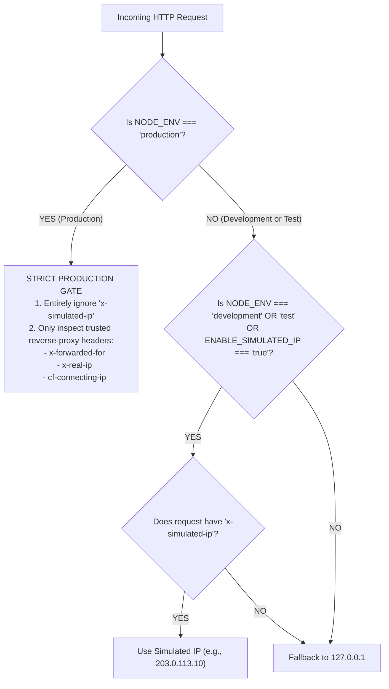

# BeltTrack Development-Only IP Rate Limiting Testing Mechanism

## 1. Overview & Purpose
In local development, all requests originating from a local machine or test runner typically share the loopback address (`127.0.0.1`). This makes it difficult to test multi-client concurrency, independent IP counter isolation, and targeted IP lockouts without switching network interfaces or using external proxies.

To solve this, BeltTrack includes a **development-only testing mechanism** that allows developers and automated test suites to simulate distinct client IP addresses using the `x-simulated-ip` HTTP header.

---

## 2. Security Architecture & Production Lockout

### Absolute Production Isolation
The simulation mechanism is **hard-locked** to non-production environments. Under no circumstances can a production client bypass or manipulate rate limits by sending `x-simulated-ip`.



### Environment Gating Code
Located in [`src/lib/rate-limit.ts`](../src/lib/rate-limit.ts):

```typescript
export function getClientIp(request: Request): string {
  const isProduction = process.env.NODE_ENV === 'production';
  const isDevOrTest =
    process.env.NODE_ENV === 'development' ||
    process.env.NODE_ENV === 'test' ||
    process.env.ENABLE_SIMULATED_IP === 'true';

  // 1. Development & Test Simulation (strictly ignored in production)
  if (!isProduction && isDevOrTest) {
    const simulatedIp = request.headers.get('x-simulated-ip');
    if (simulatedIp && simulatedIp.trim()) {
      return simulatedIp.trim();
    }
  }

  // 2. Production: Trusted reverse proxy headers only
  const xForwardedFor = request.headers.get('x-forwarded-for');
  if (xForwardedFor) {
    const firstIp = xForwardedFor.split(',')[0].trim();
    if (firstIp) return firstIp;
  }

  const xRealIp = request.headers.get('x-real-ip');
  if (xRealIp && xRealIp.trim()) {
    return xRealIp.trim();
  }

  const cfConnectingIp = request.headers.get('cf-connecting-ip');
  if (cfConnectingIp && cfConnectingIp.trim()) {
    return cfConnectingIp.trim();
  }

  // 3. Local fallback
  return '127.0.0.1';
}
```

---

## 3. How to Use the Testing Mechanism

### A. Automated Multi-IP Verification Suite
Run the pre-configured automated test runner:

```powershell
npm run test:rate-limit
```

This script ([`scripts/test-rate-limit.mjs`](../scripts/test-rate-limit.mjs)) executes 6 automated checks against the local Next.js server:

1. **Counter Sharing Verification**:
   - Sends consecutive requests with `x-simulated-ip: 203.0.113.X` (Client Alpha).
   - Verifies that `x-ratelimit-remaining` decrements sequentially (4 $\rightarrow$ 3).
2. **Counter Isolation Verification**:
   - Sends a request with `x-simulated-ip: 198.51.100.X` (Client Beta).
   - Verifies that Client Beta starts with a fresh counter (`remaining: 4`), completely unaffected by Client Alpha's previous activity.
3. **HTTP 429 Lock-Out Verification**:
   - Exhausts Client Alpha's remaining requests (Attempts 3, 4, 5).
   - On Attempt 6, asserts that the server returns `HTTP 429 Too Many Requests` with a valid `Retry-After` header and the blocked JSON message:
     ```json
     {
       "error": "Too many login attempts from this IP address. Please try again in 15 minutes."
     }
     ```
4. **Targeted Blocking Verification**:
   - Sends a second request as Client Beta (`198.51.100.X`).
   - Asserts that Client Beta remains unblocked (`HTTP 401`, `remaining: 3`), proving that blocking Client Alpha does not impact other clients.
5. **Endpoint Isolation Verification**:
   - Sends a request from locked-out Client Alpha to `GET /api/schools/directory`.
   - Asserts that the public read endpoint returns `HTTP 200`, proving rate limits are scoped by route tier.
6. **Production Safety Verification**:
   - Temporarily sets `NODE_ENV = 'production'`.
   - Passes a request with `x-simulated-ip: 8.8.8.8` alongside `x-forwarded-for: 203.0.113.199`.
   - Asserts that `getClientIp` ignores `8.8.8.8` and resolves `203.0.113.199`.

---

### B. Manual Terminal Testing (Windows PowerShell & `curl.exe`)

You can test any simulated client manually from PowerShell using `curl.exe`:

#### 1. Simulate Client Alpha (`10.0.0.1`)
```powershell
# Attempt 1: Remaining = 4
curl.exe -s -i -X POST http://localhost:3000/api/auth/login `
  -H "Content-Type: application/json" `
  -H "x-simulated-ip: 10.0.0.1" `
  -d '{"email":"test@example.com","password":"Password123!"}'

# Attempt 2: Remaining = 3
curl.exe -s -i -X POST http://localhost:3000/api/auth/login `
  -H "Content-Type: application/json" `
  -H "x-simulated-ip: 10.0.0.1" `
  -d '{"email":"test@example.com","password":"Password123!"}'
```

#### 2. Simulate Client Beta (`10.0.0.2`) Simultaneously
```powershell
# Independent counter: Remaining = 4 (unaffected by 10.0.0.1)
curl.exe -s -i -X POST http://localhost:3000/api/auth/login `
  -H "Content-Type: application/json" `
  -H "x-simulated-ip: 10.0.0.2" `
  -d '{"email":"test@example.com","password":"Password123!"}'
```

#### 3. Trigger Lockout on Client Alpha (`10.0.0.1`)
```powershell
for ($i = 1; $i -le 6; $i++) {
  $res = curl.exe -s -i -X POST http://localhost:3000/api/auth/login `
    -H "Content-Type: application/json" `
    -H "x-simulated-ip: 10.0.0.1" `
    -d '{"email":"test@example.com","password":"Password123!"}'
  $status = ($res | Select-String "HTTP/1.1 (\d+)").Matches.Groups[1].Value
  $remaining = ($res | Select-String "x-ratelimit-remaining: (\d+)").Matches.Groups[1].Value
  Write-Host "Attempt $i -> HTTP $status | Remaining: $remaining"
}
```

**Output**:
```text
Attempt 1 -> HTTP 401 | Remaining: 4
Attempt 2 -> HTTP 401 | Remaining: 3
Attempt 3 -> HTTP 401 | Remaining: 2
Attempt 4 -> HTTP 401 | Remaining: 1
Attempt 5 -> HTTP 401 | Remaining: 0
Attempt 6 -> HTTP 429 | Remaining: 0
```

---

## 4. Summary of Verification Requirements

| Requirement | How BeltTrack Enforces It | Verified By |
| :--- | :--- | :--- |
| **1. Dev/Test Only** | Evaluates `!isProduction && isDevOrTest` in [`getClientIp`](../src/lib/rate-limit.ts). | Test 6 in `npm run test:rate-limit` |
| **2. No Arbitrary IPs in Prod** | Production ignores `x-simulated-ip` unconditionally. | Test 6 in `npm run test:rate-limit` |
| **3. Automated Tests** | Multi-IP runner in [`scripts/test-rate-limit.mjs`](../scripts/test-rate-limit.mjs). | `npm run test:rate-limit` |
| **4. Same IP Counter Sharing** | Maps requests to `${ip}:${route_key}` in-memory store. | Test 1 in `npm run test:rate-limit` |
| **5. Different IP Counter Isolation** | Independent keys ensure distinct counters per IP. | Test 2 & 4 in `npm run test:rate-limit` |
| **6. HTTP 429 on Exceeded** | Next.js middleware returns RFC-compliant 429 + `Retry-After`. | Test 3 in `npm run test:rate-limit` |
| **7. Production Ignores Settings** | Gated behind strict environment check. | Test 6 in `npm run test:rate-limit` |
| **8. Zero Production Bypass** | Thresholds, windows, and security checks are never weakened. | Code review of [`src/middleware.ts`](../src/middleware.ts) |

---

## 5. Development Helpers

### Clearing Rate Limits in Development
If an IP gets locked out during manual UI testing, restart the Next.js development server (`npm run dev`) or call `resetRateLimits()` from [`src/lib/rate-limit.ts`](../src/lib/rate-limit.ts).

### Bulk Load Testing
To temporarily disable rate limiting during end-to-end load tests or database seeding, start the server with:
```powershell
$env:DISABLE_RATE_LIMIT="true"; npm run dev
```
