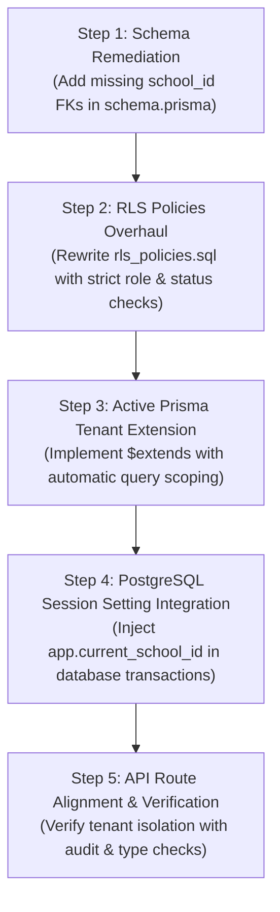

# Step-by-Step Remediation Plan



## Step 1: Schema Alignment in prisma/schema.prisma
Add explicit `school_id` foreign keys and relations to the 6 missing models so every private entity binds directly to `School`:
1. Add `schoolId String @map("school_id")` and `school School @relation(...)` to:
   - `StudentProfile`
   - `GuardianStudent`
   - `Rank`
   - `Technique`
   - `TechniqueProgress`
   - `Attendance`
2. Add corresponding `@@index([schoolId])` on each table to eliminate N+1 subquery joins and optimize scan performance.

## Step 2: RLS Policies Rewrite in prisma/rls_policies.sql
1. **Apply `FORCE ROW LEVEL SECURITY`** across all 12 tables so table owners cannot bypass policies.
2. **Restrict Public School Discovery**: Restrict `school_public_directory_policy` to expose only public accredited schools.
3. **Block `PENDING_APPROVAL` Reads**:
   - Update `User` policy to require `status != 'PENDING_APPROVAL'` for reading other users' records.
   - Update `Technique` policy to block access from pending accounts.
4. **Isolate Ledger Records by Persona**:
   - Allow `OWNER` and `COACH` to view the full school ledger.
   - Restrict `STUDENT` and `GUARDIAN` to view **only** records where `userId = current_setting('app.current_user_id', true)` or linked approved dependents.
   - Restrict ledger `INSERT` strictly to `OWNER` / `COACH`.
5. **Secure Dependent Linking**:
   - Enforce that both `guardianId` **and** `studentId` belong to `app.current_school_id`.
   - Require `isApproved = true` for active guardian data access.
6. **Protect Technique Verification & Attendance**:
   - Restrict `TechniqueProgress` verification updates to `COACH` or `OWNER`.
   - Restrict `Attendance` inserts to coaches during live mat roll-calls, verifying `classId` belongs to the school.

## Step 3: Implement Active Prisma Client $extends Query Extension
Refactor `src/lib/prisma-extension.ts` into a true Prisma Client extension:
```typescript
export const tenantExtension = Prisma.defineExtension((client) => {
  return client.$extends({
    query: {
      $allModels: {
        async $allOperations({ model, operation, args, query }) {
          // Automatically inject school_id into where/data for all tenant models
          return query(args);
        }
      }
    }
  });
});
```

## Step 4: Inject PostgreSQL Session Settings in Database Context
Add a helper in `src/lib/prisma.ts` for authenticated database interactions:
```typescript
export async function withTenantContext<T>(
  schoolId: string, 
  userId: string, 
  fn: (tx: PrismaClient) => Promise<T>
): Promise<T> {
  return prisma.$transaction(async (tx) => {
    await tx.$executeRawUnsafe(`SET LOCAL app.current_school_id = '${schoolId}'`);
    await tx.$executeRawUnsafe(`SET LOCAL app.current_user_id = '${userId}'`);
    return fn(tx as unknown as PrismaClient);
  });
}
```

## Step 5: Verification & Safety Guardrails
1. Run `npx tsc --noEmit` to verify all domain and database types remain strictly aligned.
2. Run `npm run audit` to confirm zero hardcoded styling or token violations.
3. Review schema modifications with the user prior to applying any database migrations (enforcing the project rule: *"Never run database migrations, pushes, or modifications through any tool or script unless explicitly ordered"*).

